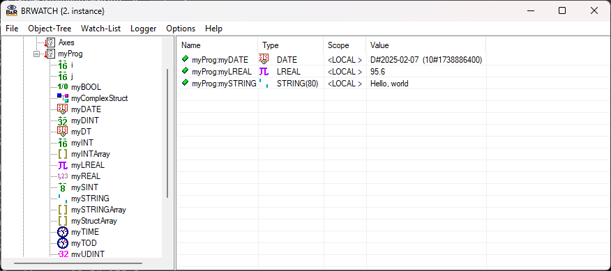
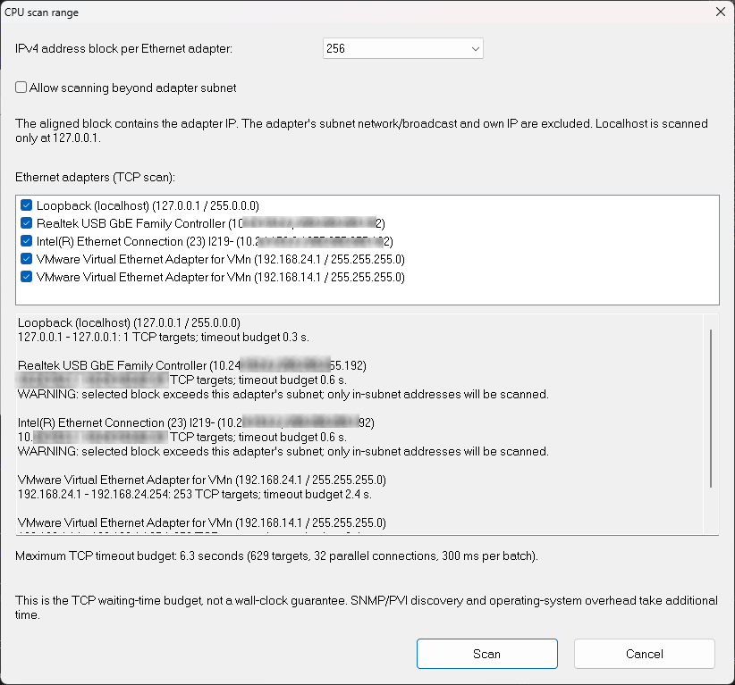
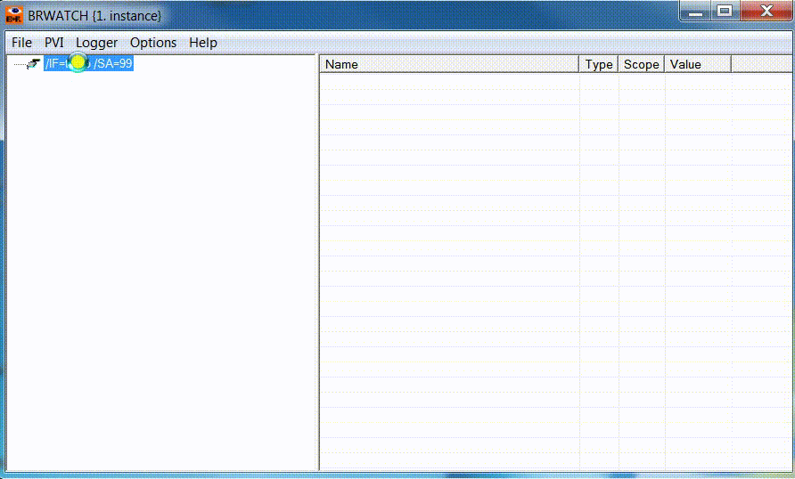
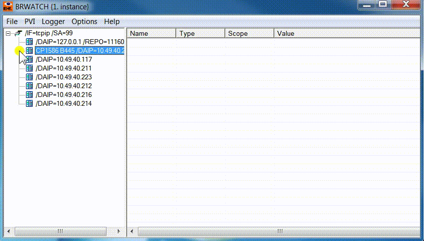
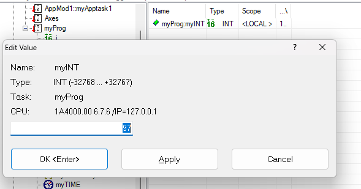
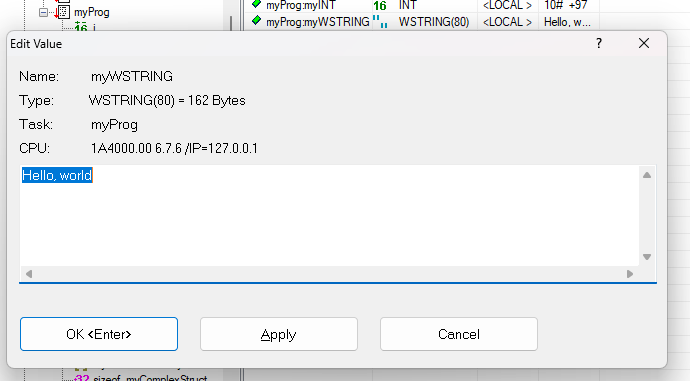
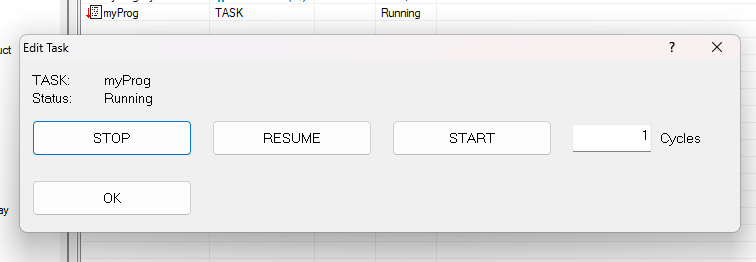
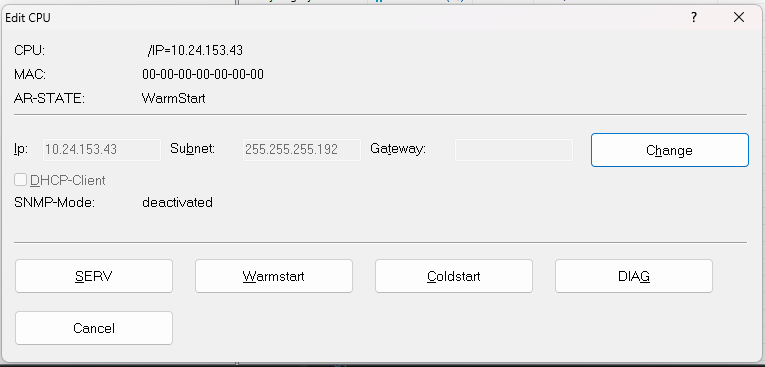
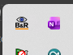

# [brwatch](http://hilch.github.io/brwatch)

## Installation

in brief: there is no special installation. Just copy brwatch.exe to a directory with write permission.
we need to store an *.ini file and a log file int the same place.
brwatch.exe requires PVI development to be preinstalled on the target pc.

With Runtime Utility Center (RUC) it is possible to create an "installation package", which contains your project binaries but also PVI binaries (*.exe,*.dll).
Just copy brwatch.exe to this installation package to get a complete portable version.

## Settings

BRWATCH reads and saves its settings in **%APPDATA%\brwatch\brwatch.ini** when the `APPDATA` environment variable is set. Otherwise, it uses **brwatch.ini** in the current folder. On first start, the settings folder and file are created if needed.
To edit these settings use an external editor or the built-in one in menu Options/Settings.
Refer to the comments in this file and the PVI- documentation that comes with the installation package of **PVI development setup**.

## Main Window

Select CPUs, Tasks and Variables from the Tree and Drag it to the List on the right to watch or edit their settings / values. See menu 'Watch-List' or right-click context menu.

## Scan for PLCs in network

A click on the tcpip device starts SNMP discovery and a TCP port scan on port 11169 (standard port for ANSL). The number of scanned hosts can be adjusted as well.

In the CPU scan range dialog, uncheck Ethernet adapters to exclude them from the TCP scan. All adapters, including localhost, are checked by default whenever the dialog opens. The scan preview and timeout budget include only checked adapters; Scan is disabled when no selected adapter has usable targets. These choices do not restrict the separate SNMP/PVI discovery.
Hosts accepting a connection are added with their IP address and subnet mask; an open port alone does not verify that the host is a B&R PLC. Additional CPU information comes from SNMP when available.
CPUs outside your network cannot be found with these methods. The communication settings have to be entered in brwatch.ini instead (see menu Object-Tree/Add Cpu).

## Searching for PV (process variables)

To scan variables, left-click on each node-entry of the tree view control.
To watch a selected variable just drag it to the list view control at the right.
The entries can be freely arranged by drag and drop operations.

If you drag an entry outside BRWATCH, it will removed from the list view.
Select entries in the watch list and choose **Watch > Remove** (or press Delete)
to remove them from the watch list without deleting their PVI objects.

Set `object_refresh_time` in the `[General]` section of `brwatch.ini` to configure
the PVI process-variable refresh time in milliseconds. The default is `50` when
the setting is absent. Restart BRWATCH after changing this value.

## Change number representation

Right-Click on an entry in the list view opens a context menu for further settings (e.g.
Representation of integer variables and strings).
TODO screenshot

## Edit values

To change a value, double-click the entry in the list view, select it and choose
**Watch > Edit**, or press Enter. Editing requires `[General] WriteAllowed=1`
in `brwatch.ini`. Watch editing and removal are disabled while logging is running.
The following dialog window enables to enter a new value.

In **Edit Value**, use **Enter** (OK), **Alt+A** (Apply), and **Esc** (Cancel).
The buttons show `OK <Enter>` and `Cancel <Esc>`. Tab and Shift+Tab move
between fields and buttons. Underlined letters show the Alt-key shortcuts.
For date/time values, **Alt+Y**, **Alt+M**, **Alt+D**, **Alt+H**, **Alt+N**, and
**Alt+I** focus the enabled year, month, day, hour, minute, and millisecond fields.

### Strings

## Edit Tasks

Task can be stopped, restarted and executed for a number of specified cycles (single steps)

## Edit CPUs

You can execute some commands to a CPU:

- Warmstart
- Coldstart
- Stop
- Diagnose
- Change the IP settings (since V1.2)

In **Edit CPU**, the button shortcuts are **Alt+C** (CHANGE), **Alt+S** (SERV),
**Alt+W** (Warmstart), **Alt+O** (Coldstart), **Alt+G** (DIAG), and **Esc** (Hide).
Use **Alt+D** for the DHCP checkbox; **Alt+I**, **Alt+B**, and **Alt+T** focus the
IP address, subnet, and gateway fields when enabled. The close button shows `Hide <Esc>`.

## File operations

You can load/save the watch configuration via "File" menu.

## Logger

If the list view contains one or more PV you can write the values into a CSV- File. **Microsoft Excel** or **Libre Office Calc** can open this file type for example (or an ordinary text editor of course).

The default filename is `logger.csv` in your Windows home folder (usually
`C:\Users\<username>`). A filename saved in the logger settings overrides this default.

The CSV- file size can be limited. If the entries exceeds this size, the earlier file is renamed (extended with date and time settings) and a new file will be written.

If option **write only when value change** is checked, a row is written if at least one variable in the list view has changed its content (minimize size).
Otherwise, the entered cycle time is for each row no matter if values have changed in a new cycle.
Each row in the CSV- file will contain a timestamp. This will come from the first CPU listed in the list view.
Furthermore, the CSV- files can compressed via ZIP- algorithm. Extract these files later on by BRWATCH (Menu File) or with a separate tool (WinZIP, 7zip e.g.)
Pressing **OK** will save these settings in the BRWATCH.ini file.

### Starting and Stopping the Logger

Menu Logger enables to start the logger or to stop a started logging. If logging has started, the BRWATCH main window is grey colored to signal this state.
TODO Screenshot
You can save space on your Window desktop by minimizing the window. BRWATCH will then be visible only as an icon in the taskbar. Moving the mouse over this icon gives the option to maximize the main window again.

If you close BRWATCH in this state (e.g. power down your PC) the logger will start in this state again after power up (for long term logging capabilities).
Beware; the minimized window state is be saved, too.
So if you don't see the main window after starting the .exe just have a look at the windows taskbar.
